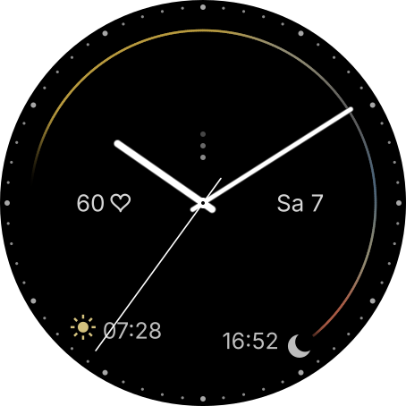

# smartwatch-designs

Free, open-source watch faces for Garmin® smartwatches, built with the Connect IQ™ SDK.

> **Status:** in development. *Schlicht* runs on a Venu 3 as a private beta app; it is not published in the Connect IQ Store yet. For now you build and install it yourself (see [Build it yourself](#build-it-yourself)).

## Schlicht – a plain analog watch face

*Schlicht* is German for "plain". Slim white hands and a ring of small grey dots on a black background, with a few things quietly in the background – all in black, white and greys, with a touch of colour for the weather.

<p align="center"></p>

*Preview rendering at 454 × 454 px with example data (10:09, sunny morning, clouds and rain in the afternoon, three unread notifications).*

### Features

- **Hands and dial:** slim white hour, minute and second hand with soft edges; 60 small grey minute dots right at the edge, every fifth one a little larger and lighter. No numerals.
- **Day arc:** a fine arc from the hour hand to sunset shows how much daylight is left.
  - Softly coloured by the hourly forecast: muted yellow for sun, grey for clouds, blue-grey for rain, cool grey for snow, evening red before a clear sunset. Colours blend smoothly from hour to hour.
  - Fades in about an hour before the hour hand and fades out towards sunset.
  - Sunrise is marked with a small yellowish sun, sunset with a small crescent moon, each with its time (12/24-hour as set on the watch).
  - At night the arc is hidden; only the sun and moon markers with their times remain. Without weather data the arc stays grey.
- **Date** at 3 o'clock, e.g. "Sa 7", in your watch's language.
- **Heart rate** at 9 o'clock: the heart is always there, exactly as tall as the date digits; the number appears to its left only while a live reading is available.
- **Notifications:** one small dot per unread phone notification, stacked towards 12 o'clock and fading as they go up. **Press and hold** the dots to open the notification list.
- **Always-on mode:** only thin hands and twelve dots, shifting a few pixels every minute to follow Garmin's burn-in rules for AMOLED screens.

### Settings

Open the **Connect IQ** app on your phone → *My Device* → *Watch Faces* → *Schlicht* → *Settings*:

| Setting | Options | Default |
|---|---|---|
| Second hand | On · Off | On |

The second hand is only visible while the watch is "awake" (after a wrist turn or a tap). In always-on mode the watch updates the screen only once a minute.

### Privacy and permissions

- No internet access of its own, no background service, no data collection, no tracking.
- Permission **ComplicationSubscriber**: fallback for sunrise and sunset, and opening the notification list.
- Weather comes from the watch's own weather data (delivered by the Garmin Connect app); the heart rate from the watch's sensor.

### Supported watches

| Watch | Screen | Status |
|---|---|---|
| Venu 3 | 454 × 454, round, AMOLED | target device, tested on the watch |
| Venu 3S | 390 × 390, round, AMOLED | builds, not yet tested on a watch |

All sizes are designed for 454 px and scaled to the screen, so other round watches with Connect IQ API 4.2 or newer can be added in `manifest.xml`.

## Build it yourself

### What you need

1. A free [Garmin developer account](https://developer.garmin.com/connect-iq/).
2. The [Connect IQ SDK Manager](https://developer.garmin.com/connect-iq/sdk/). Use it to download the current SDK (tested with 9.3.0) and the device files for *Venu 3*.
3. A Java runtime, JDK 17 or newer (tested with 21).
4. Optional: [Visual Studio Code](https://code.visualstudio.com/) with Garmin's [Monkey C extension](https://marketplace.visualstudio.com/items?itemName=garmin.monkey-c) (identifier `garmin.monkey-c`). The extension is only on Microsoft's marketplace, not on Open VSX: in VSCodium or other forks, download the `.vsix` from the marketplace page and install it with *Extensions → … → Install from VSIX*.

### Developer key

Every build is signed with your own developer key. Create one with **Monkey C: Generate a Developer Key**, or:

```sh
mkdir -p ~/.garmin && cd ~/.garmin
openssl genrsa -out developer_key.pem 4096
openssl pkcs8 -topk8 -inform PEM -outform DER -in developer_key.pem -out developer_key.der -nocrypt
```

Keep it **outside this repository**, back it up, and always use the same key for updates. In VS Code set *Monkey C: Developer Key Path* in your **user** settings (full path, no `~`); otherwise the build fails with `Unable to load private key: undefined`.

### Run in the simulator

**With VS Code:** open the folder `watchfaces/schlicht` (not the repository root), press `F5` and choose *Venu 3*. If `F5` does nothing, create a launch configuration via *Run and Debug → create a launch.json file → Monkey C*.

**From the command line:**

```sh
SDK=$(cat ~/.Garmin/ConnectIQ/current-sdk.cfg)
cd watchfaces/schlicht
"$SDK/bin/monkeyc" -f monkey.jungle -d venu3 -y ~/.garmin/developer_key.der -o bin/schlicht.prg
"$SDK/bin/connectiq" &          # start the simulator
"$SDK/bin/monkeydo" bin/schlicht.prg venu3
```

In the simulator:

- *Settings → Low Power Mode* shows the always-on view and reports burn-in problems.
- *File → Edit Persistent Storage* changes the settings.
- Time, weather, heart rate and notifications have to be simulated (menus *Simulation* and *Settings*); without them the day arc stays grey and dots and heart rate number are hidden.

### Simulator on Linux

The Connect IQ simulator needs **WebKitGTK 4.0** (`libwebkit2gtk-4.0.so.37`), which many current distributions (Arch/Manjaro, Debian 13, recent Fedora) no longer ship. Symptom: the build succeeds, but no simulator appears and `monkeydo` reports `Unable to connect to simulator`. Check with:

```sh
SDK=$(cat ~/.Garmin/ConnectIQ/current-sdk.cfg)
ldd "$SDK/bin/simulator" | grep "not found"
```

If libraries are missing, run just the simulator in an Ubuntu 22.04 container with [Distrobox](https://distrobox.it/). It shares your home directory and network, so the SDK and this project are available inside:

```sh
distrobox create --name ciq --image ubuntu:22.04
distrobox enter ciq -- sudo apt update
distrobox enter ciq -- sudo apt install -y libsm6 libice6 libxext6 libxrender1 libxtst6 libxi6 \
  libgtk-3-0 libgl1 libglu1-mesa libnotify4 libjpeg-turbo8 libpng16-16 \
  libusb-1.0-0 libsecret-1-0 libwebkit2gtk-4.0-37 fonts-dejavu-core

# start the simulator in the box, build on your normal system, load from the box:
distrobox enter ciq -- "$SDK/bin/connectiq" &
cd watchfaces/schlicht
distrobox enter ciq -- "$SDK/bin/monkeydo" "$PWD/bin/schlicht.prg" venu3
```

### Install on your watch

**Via USB (quick test, no settings):**

```sh
"$SDK/bin/monkeyc" -f monkey.jungle -d venu3 -r -y ~/.garmin/developer_key.der -o bin/schlicht-venu3.prg
```

Note the device `venu3` – VS Code builds for `venu3_sim` when running the simulator. Connect the watch (it shows up as an MTP device), copy the `.prg` to `GARMIN/Apps/`, disconnect, then press and hold the watch face → *Watch Face* → *Schlicht*. Settings in the phone app are not available for side-loaded watch faces.

**As a beta app (with settings and updates):**

1. Export a store package: **Monkey C: Export Project**, or `monkeyc -f monkey.jungle -e -r -y <key> -o bin/schlicht.iq`.
2. Upload it as a **beta app** in the developer dashboard: <https://apps.garmin.com/developer/dashboard> (new address: <https://apps-developer.garmin.com>). Beta apps are visible only to you and stay "pending" forever – that is normal.
3. Beta apps do not appear in the store search. Open the app in the dashboard, copy its store ID from the URL and open `https://apps.garmin.com/de-DE/apps/<store-id>` **on your phone**; it opens in the Connect IQ app, where you install it. The phone must be signed in with the same Garmin account.
4. For updates, upload the new `.iq` as a new version of the same beta app.

## How it works

```
watchfaces/schlicht/
  source/SchlichtApp.mc        entry point, settings changes
  source/SchlichtView.mc       drawing: dial, hands, day arc, date, heart rate, always-on
  source/WeatherArc.mc         forecast → colours along the day arc
  source/SchlichtDelegate.mc   press-and-hold on the notification dots
  source/Layout.mc             shared positions and sizes (454 px design)
  resources/ resources-deu/    strings (English, German), settings, launcher icon
barrels/notification-dots/     reusable module (Monkey C barrel) for the notification dots
docs/images/                   preview images used in this README
docs/ci/build.yml              CI build template (see below)
tools/render_previews.py       regenerates the preview image and the launcher icon
```

| Shown | Source |
|---|---|
| Sunrise, sunset | `Weather.getSunrise/getSunset` for the weather location, fallback: native complications `COMPLICATION_TYPE_SUNRISE/SUNSET` |
| Date | `Time.Gregorian` (weekday abbreviation in the watch's language, day without leading zero) |
| Day arc colours | `Weather.getCurrentConditions()` and `Weather.getHourlyForecast()`, rebuilt every 10 minutes |
| Heart rate | `Activity.getActivityInfo().currentHeartRate` (live value only) |
| Notifications | `System.getDeviceSettings().notificationCount`; press-and-hold opens `COMPLICATION_TYPE_NOTIFICATION_COUNT` |

Drawing notes: hands are filled polygons, so fractional widths work with anti-aliasing; their soft edge is two slightly wider grey layers (white at 25 % and 50 % over black). Colours are only set with `setColor`: the alpha fill tool `setFill` is avoided, because opaque white as ARGB (`0xFFFFFFFF`) equals `-1`, which Connect IQ treats as `COLOR_TRANSPARENT`. Text is positioned by its cap height (derived from `getFontAscent`), so digits and the heart line up exactly. Sunrise and sunset come from `Weather.getSunrise/getSunset` for the weather location (falling back to the native complications). `drawArc` only takes whole degrees, so the day arc is drawn in 1–2° pieces.

## Notification dots as a reusable module

`barrels/notification-dots` is a Monkey C *barrel* that any watch face can include:

```monkeyc
// in onUpdate(): first dot at (cx, firstY), the column grows upwards
NotificationDots.draw(dc, cx, firstY, scale);   // scale = screen width / 454

// in a WatchFaceDelegate: open the notification list on press-and-hold
function onPress(clickEvent as WatchUi.ClickEvent) as Boolean {
    var xy = clickEvent.getCoordinates();
    if (NotificationDots.contains(xy[0], xy[1], cx, firstY, scale)) {
        Complications.exitTo(new Complications.Id(Complications.COMPLICATION_TYPE_NOTIFICATION_COUNT));
        return true;
    }
    return false;
}
```

To use it:

1. `manifest.xml`: add `<iq:depends name="NotificationDots" version="0.1.0"/>` under `<iq:barrels>` and the permission `ComplicationSubscriber` (for opening the list).
2. `monkey.jungle`: `base.barrelPath = path/to/barrels/notification-dots/monkey.jungle`.

One dot per unread notification (up to five), each darker than the one below; the fifth has faded to black.

## Preview images

`tools/render_previews.py` draws the README image with the same geometry as the watch face (no dependencies; PNG export needs `rsvg-convert` from librsvg):

```sh
python3 tools/render_previews.py
```

## Continuous integration

`docs/ci/build.yml` is a GitHub Actions template that builds the `.prg` and `.iq`. Garmin only hands out the SDK device files after login, so it uses [connect-iq-sdk-manager-cli](https://github.com/lindell/connect-iq-sdk-manager-cli) with repository secrets (`GARMIN_USERNAME`, `GARMIN_PASSWORD`, `CIQ_AGREEMENT_HASH`, `CIQ_DEVELOPER_KEY_B64`). Copy it to `.github/workflows/` once the secrets are set; a separate Garmin account without two-factor authentication is recommended. The template is not tested yet.

## Contributing

Issues and pull requests are welcome. Please keep the watch faces simple, battery friendly and free of tracking. Never commit developer keys, account data or other secrets.

## License

[MIT](LICENSE).

Garmin, the Garmin logo, Venu and Connect IQ are trademarks of Garmin Ltd. or its subsidiaries. This project is an independent work and is not affiliated with, endorsed or sponsored by Garmin.
